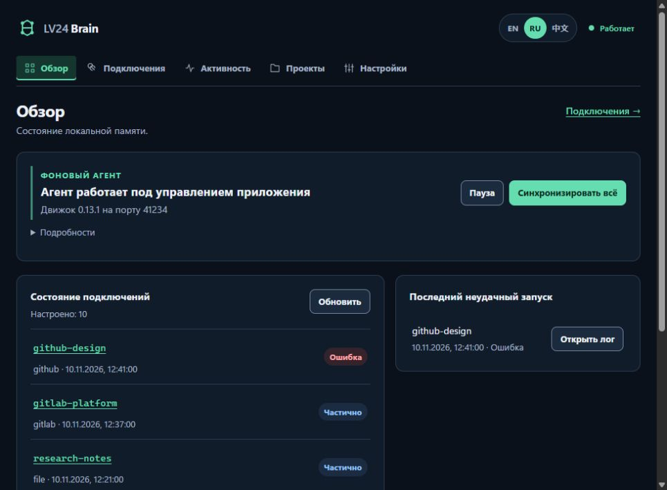

# LV24 Brain Desktop

[](https://github.com/LevapVeeskela/lv24-brain-desktop/actions/workflows/ci.yml)

The local memory control app for [LV24 Brain](https://github.com/LevapVeeskela/lv24-brain),
built with Tauri v2. See connection results, investigate failed runs and manage
the background agent, schedules and credentials from one offline-first interface.

**Status: v1.1.0, design refresh + recovery/cancel hardening.** The dashboard, connections list, add
connection wizard, connection detail (schedule, credentials, runs, received logs),
activity, projects and settings screens are implemented. Packaging bundles a
checksum-pinned engine sidecar; the WP5.5 pass added accessible dialogs, phase-
based engine recovery, truthful offline/paused states and update progress.

The `design/ux-refresh` branch adds a semantic dark theme, a shared memory mark,
last-known connection results, a clearer setup wizard and persistent feedback.
Versions and engine/API contracts are unchanged. See the
[design audit](docs/design-refresh.md), [verification report](docs/design-refresh/report.md)
and [before/after screenshots](docs/design-refresh/screenshots/README.md).



## What works

- **Tray** with a status dot, agent state, Sync all, Pause/Resume, Open and Quit.
- **Agent supervision**: spawns `brain agent --parent-pid <desktop>`, watches
  the runtime record, restarts an unexpected exit with backoff and stops the
  agent gracefully on quit.
- **Single instance**: a second launch focuses the existing window.
- **Autostart**: HKCU Run on Windows, XDG autostart on Linux, and
  `SMAppService.mainApp` on macOS 13+. Starts hidden in the tray with
  `--autostart`.
- **Local API proxy**: the webview calls `api_request` / `run_log_open`; the
  Rust process adds the bearer token. The token never enters JavaScript.
- **Ed25519 updater**: Tauri updater signatures verified against the public key
  in `src-tauri/tauri.conf.json`; check and install commands are implemented.
- **OAuth deep links**: registers `lv24brain://`, validates only
  `lv24brain://oauth/...` and `lv24brain://auth/...`, buffers the URL for the UI
  and emits `oauth-callback`. The engine OAuth wiring is consumed by WP5.3.
- **Persistent pause**: pausing stops the agent and survives desktop restarts.
- **FSD UI foundation (v0.2.0)**: `app / pages / widgets / features / entities /
  shared`, MobX stores for Engine, Connections, Sync and Settings, shared UI
  primitives.
- **Typed local API client (v0.2.0)**: generated from the vendored
  `localapi-v1` OpenAPI file; `openapi-fetch` uses a custom Tauri transport, so
  the webview never sees the bearer token or loopback port.
- **i18n (v0.2.0)**: English, Russian and Chinese dictionaries with a typed key
  set, persisted locale and a header switcher.
- **Screens (v0.3.0)**: dashboard, connections list, add-connection wizard
  (provider descriptors, auth modes, settings, secrets, save + test),
  connection detail (schedule, credentials, runs, SSE log output, OAuth, delete),
  activity, projects and settings (paths, autostart, language, desktop update,
  update channel and OS keychain secret names).
- **Packaging (WP5.4)**: manual `desktop.yml` builds NSIS (Windows),
  DMG + app zip + `.app.tar.gz` (macOS arm64/x64), and AppImage + deb + rpm
  (Linux) with a checksum-pinned engine sidecar, 7-day artifacts, and an
  owner-gated signed release path. Updater manifests include all six
  platform entries (including deb/rpm) and `requireSignedVersion` is enabled.
  See [docs/release.md](docs/release.md).
- **UX and accessibility (WP5.5)**: phase-based Start/Pause/Resume, truthful
  unavailable/paused/loading/stale states, localized errors, skip link and
  per-route focus/title, accessible confirm dialogs, form labels/validation,
  OAuth success/failure/callback hardening, live log follow and stable ids,
  update confirmation/progress/locks, autostart retry, dashboard sync retry,
  and contrast/focus/reduced-motion fixes across ru/en/zh.
- **Read-only engine CLI bridge (v0.3.0)**: `engine_providers`,
  `engine_secrets` and streaming `engine_connection_auth` commands reuse the
  engine binary/config; the webview never receives a secret value.
- **Structured tests** for path allow-listing, config discovery, runtime
  records, SSE parsing, settings persistence, the HTTP proxy, the typed
  transport, API parsers, stores, provider descriptors and i18n key parity.

## Architecture

```
┌──────────────────────────────┐
│ Webview (React + TS)         │
│  invoke("shell_status")      │
│  invoke("api_request", ...)  │──┐  no token, no port
└──────────────────────────────┘  │
                                  ▼
┌──────────────────────────────┐   ┌──────────────────────────────┐
│ Rust shell                   │   │ brain agent (sidecar/PATH)   │
│  supervisor ─────────────────┼──▶│  loopback API + scheduler    │
│  proxy (bearer token) ───────┼──▶│  agent/runtime.json (0600)   │
│  tray / autostart / updater  │   └──────────────────────────────┘
│  deep-link router            │
└──────────────────────────────┘
```

See [docs/architecture.md](docs/architecture.md) and
[docs/security.md](docs/security.md).

## Requirements

- Node.js 22+ (CI uses 24) and npm.
- Rust 1.90+ with the platform toolchain (MSVC on Windows).
- Tauri v2 system prerequisites for your OS.
- The LV24 Brain engine `0.14.0` or newer, initialized with `brain init` and
  selected with `brain config use <path>` (or `BRAIN_CONFIG`).

The engine sidecar is fetched per target during packaging CI; see
[docs/release.md](docs/release.md). Local development still resolves the engine
in this order:

1. `LV24_BRAIN_BIN`
2. `<resource-dir>/engine/brain[.exe]` or `<resource-dir>/brain[.exe]`
3. `<app-dir>/engine/brain[.exe]` or `<app-dir>/brain[.exe]`
4. `PATH`
5. the npm global platform package (`@lv24/brain-<os>-<arch>`)

Release installers bundle `brain` next to the desktop executable through the
`src-tauri/tauri.bundle.conf.json` override.

## Development

```bash
npm install
npm run tauri dev
```

Useful environment variables:

| Variable | Meaning |
| --- | --- |
| `LV24_BRAIN_BIN` | Absolute path to the engine executable. |
| `BRAIN_CONFIG` | Explicit `brain.yaml` (the engine's own variable). |
| `LV24_BRAIN_CONFIG` | Desktop override for `BRAIN_CONFIG`. |
| `WEBVIEW2_ADDITIONAL_BROWSER_ARGUMENTS` | `--remote-debugging-port=9222` for local CDP smoke tests. |

Checks:

```bash
npm run typecheck
npm test
npm run build
npm run api:check
cd src-tauri
cargo fmt --all --check
cargo clippy --all-targets -- -D warnings
cargo test
```

`npm run api:generate` regenerates `src/shared/api/generated/schema.d.ts` from
`src/shared/api/openapi/localapi-v1.json`. The OpenAPI file is a copy of the
engine's `internal/adapters/localapi/openapi.json`; keep them in sync when the
`localapi-v1` contract changes. `api:check` fails if the generated file is stale.

A full desktop build without an installer:

```bash
npm run tauri build -- --debug --no-bundle
```

A local packaged build with the engine sidecar (Windows example; derive the
target triple with `rustc -vV` on other hosts):

```bash
node scripts/fetch-engine.mjs --version 0.12.0 \
  --target x86_64-pc-windows-msvc
npm run tauri build -- --debug --bundles nsis \
  --config src-tauri/tauri.bundle.conf.json \
  --config src-tauri/tauri.unsigned.conf.json
```

See [docs/release.md](docs/release.md) for the CI matrix, release gating and
artifact list.

## Packaging and release

`.github/workflows/desktop.yml` is a manual workflow that builds NSIS (Windows),
DMG + app zip + `.app.tar.gz` (macOS arm64/x64), and AppImage/deb/rpm (Linux) on
free standard runners. It downloads the matching engine release with
`scripts/fetch-engine.mjs`, verifies its release checksum and reviewed pin, and
bundles it as a Tauri sidecar. Artifacts are retained for 7 days; publishing a
GitHub release is an explicit owner-gated input and requires a signed build and
tag.

Updater signing uses `TAURI_SIGNING_PRIVATE_KEY` and
`TAURI_SIGNING_PRIVATE_KEY_PASSWORD` repository secrets. The current public key
is a development key; rotate it before a public release. OS code signing remains
deferred until Apple Developer Program and SignPath approvals.

## Updates and signing

The updater is enabled with Tauri's Ed25519 (minisign-compatible) signatures.
The public key is committed in `src-tauri/tauri.conf.json`. The private key is
**not** in this repository. `requireSignedVersion` binds each update signature
to the app version, preventing manifest downgrade substitution.

The current public key belongs to the development key generated for the v0.1.0
shell. Before the first public release:

1. Generate a production key and store the private key in the release secret
   store (`TAURI_SIGNING_PRIVATE_KEY` / `TAURI_SIGNING_PRIVATE_KEY_PASSWORD`).
2. Replace `plugins.updater.pubkey` with the new public key.
3. Build installers with `createUpdaterArtifacts: true` and publish a
   `latest.json` at the endpoint in `tauri.conf.json`
   (`https://github.com/LevapVeeskela/lv24-brain-desktop/releases/latest/download/latest.json`).
4. Keep the previous public key available for one release so existing installs
   can migrate, then retire it.

Signing status: macOS signing/notarization waits for Apple Developer Program
approval; Windows signing waits for SignPath Foundation approval. Until then,
release test builds are unsigned and will show SmartScreen/Gatekeeper warnings.

## Known limitations (v1.1.0)

- Local `cargo`/Vite development still resolves the engine from the
  environment; only packaged builds include the sidecar.
- Pause stops the agent. If an agent was started outside the desktop, Pause
  asks it to shut down through the local API; if it refuses, the shell reports
  an error instead of pretending it is paused.
- The local API is single-user and loopback-only; the bearer token grants full
  local control. Same-user malware can read `agent/runtime.json`, as documented
  by the engine's security acceptance.
- macOS autostart requires the signed app bundle and macOS 13+.
- OAuth callbacks are routed to the UI and the detail page can run the engine
  OAuth command; a live GitHub/GitLab OAuth app validation still needs client
  IDs from the owner.
- Settings displays the data directory/update channel but does not edit
  `brain.yaml`; use the engine CLI or edit the file.
- Provider config labels/help come from the engine descriptors and are English;
  the desktop chrome is fully localized.
- The release matrix currently builds Windows x64, Linux x64, and macOS
  arm64/x64. Windows arm64 and Linux arm64 installers are not in the initial
  matrix.
- OS code signing/notarization remains deferred to Apple/SignPath approvals.

## License

Apache-2.0. See [LICENSE](LICENSE).
