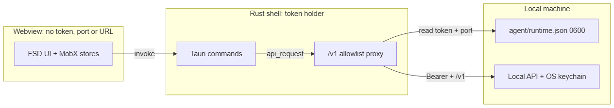
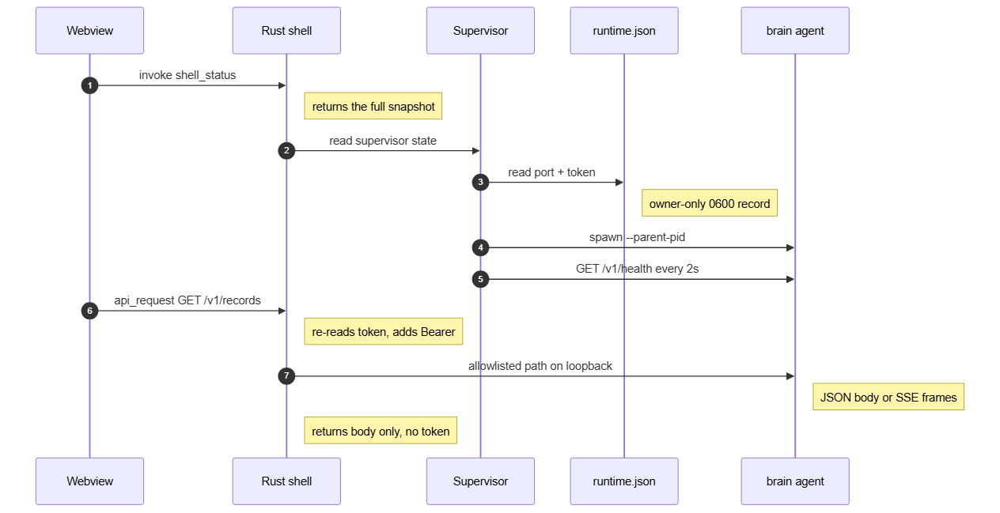
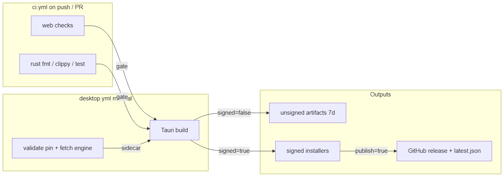

# LV24 Brain Desktop — system design

Status: current for desktop **1.7.2** (2026-11-27). The older
[architecture-deep-dive.md](architecture-deep-dive.md) remains as a historical
deep dive into the WP5.1–WP5.5 implementation and desktop 1.2 detail; this file
is the current source of truth for the system.

## 1. Purpose and scope

LV24 Brain Desktop is a local-first control surface for one LV24 Brain data
directory. It lets the owner see whether the engine agent is healthy, manage
connections and schedules, read run logs, browse curated project memory, review
proposals and keep desktop settings — without exposing the local API token or
loopback port to the webview.

In scope:

- supervise the local `brain agent` process for the configured data directory;
- proxy the frozen `localapi-v1` contract through an allowlisted Rust layer;
- render the UI from a typed client, FSD slices and MobX stores;
- package installers with a checksum-pinned engine sidecar and signed updates.

Out of scope (deliberate):

- a hosted or multi-user service; there is no remote API and no server mode;
- editing `brain.yaml` (Settings displays paths, not the engine file);
- reading credential values (the desktop lists names and status only);
- bundling a second engine, a second data directory or a second agent lock;
- OS code signing until Apple/SignPath approvals exist (updates are still
  Ed25519-signed).

## 2. System context and trust boundaries

Actors: the owner at the desktop window, the Rust shell, the bundled or
environment-resolved `brain` binary, and the local loopback HTTP API served by
`brain agent`. External systems are limited to the GitHub release endpoint used
by packaging and the updater, the engine's own provider connections (which run
inside the agent, not the shell), and the OS keychain used by the engine.



Trust boundary summary:

| Boundary | Holds | The webview may |
|---|---|---|
| Webview (bundled React) | UI state, typed response data | call Tauri commands only |
| Rust shell | bearer token, loopback port, engine paths, updater key verification | read the runtime record, spawn/probe the agent, stream SSE |
| `brain agent` | connection credentials, provider sessions, engine data | serve `/v1/*` on loopback |
| OS | keychain, file permissions, code-signing identity | gate file and key access |

The token and port live in `data_dir/agent/runtime.json`, which the engine
writes with owner-only permissions. The shell rejects symlinked runtime files,
warns on Unix world/group-readable permissions, requires a token of at least 32
characters and non-zero port/PID, and redacts the token from `Debug` output.
Errors and events carry the URL without a token.

## 3. Runtime components

| Component | Responsibility | Entry file | Port / store |
|---|---|---|---|
| Tauri bootstrap | Plugin order, managed state, window lifecycle | `src-tauri/src/lib.rs`, `main.rs` | window `main` |
| Command surface | `shell_status`, start/pause/sync, autostart, updates, quit, external links | `src-tauri/src/commands.rs` | Tauri IPC |
| Engine supervisor | Resolve paths/binary, spawn, health probe, pause/resume, restart backoff, shutdown | `src-tauri/src/engine/supervisor.rs` | child process |
| Engine paths | Resolve `brain.yaml`, data dir and `brain` binary in the documented order | `src-tauri/src/engine/paths.rs` | filesystem |
| Runtime record | Read `agent/runtime.json`, validate, redact token | `src-tauri/src/engine/runtime.rs` | 0600 file |
| CLI bridge | Fixed engine subcommands (`providers`, `secret list`, `connection auth`) | `src-tauri/src/engine/cli.rs` | child process; auth timeout 5 min |
| HTTP proxy | Bearer-authenticated loopback client; no proxy, no redirects, 2 MiB response cap | `src-tauri/src/api/client.rs` | loopback |
| Path allowlist | `/v1/` only; method, length and traversal checks | `src-tauri/src/api/path.rs` | in-process |
| SSE parser | Byte-level `text/event-stream` frames for run logs | `src-tauri/src/api/sse.rs` | in-process |
| Proxy commands | `api_request`, `run_log_open`, `run_log_close`; emits `run-log` | `src-tauri/src/api/mod.rs` | Tauri IPC |
| Tray | Status dot, agent state, Sync all, Pause/Resume, Open, Quit | `src-tauri/src/tray.rs` | OS tray |
| Autostart | HKCU Run (Windows), XDG (Linux), `SMAppService` (macOS 13+) | `src-tauri/src/autostart.rs` | OS login items |
| Deep links | Register `lv24brain://`, validate `oauth/` and `auth/` URLs, buffer and emit | `src-tauri/src/deep_link.rs` | OS scheme |
| Watchdog / lifecycle | Detect a dead or hung UI, restart hints, unclean-session diagnostics | `src-tauri/src/watchdog.rs`, `lifecycle.rs` | local files |
| Desktop settings | `paused`, optional config path, locale/update preferences | `src-tauri/src/settings.rs`, `src/shared/…/settings` | Tauri app config dir |
| Typed client | `openapi-fetch` over a Tauri `fetch` replacement | `src/shared/api/`, `generated/schema.d.ts` | in-process |
| FSD UI | Routes, widgets, features and stores for every screen | `src/main.tsx`, `src/app/App.tsx` | WebView memory |
| i18n | Typed `en`/`ru`/`zh` dictionaries with key-parity tests | `src/shared/i18n/messages/` | local storage |

### Frontend layers (FSD)

```
src/
  app/        RootStore composition, providers, HashRouter, layout, global.css
  pages/      dashboard, memory, inbox, quarantine, search, projects,
              project-detail, activity, connections, connection-detail,
              connection-wizard, git-sync, settings, not-found
  widgets/    app header/rail, engine overview/card, paths, connections,
              run log panel
  features/   engine controls, autostart, update check, locale, OAuth callback,
              command palette
  entities/   engine, connection, run, project, provider, sync, settings, memory
  shared/     API transport/client, i18n, UI primitives, error/format helpers
```

Dependencies point downward only; slices expose their public API through
`index.ts`. `RootStore` is created once by `RootStoreProvider`, which owns
polling subscriptions and disposes them on unmount. `HashRouter` keeps packaged
builds free of server routes.

| Store | Owns |
|---|---|
| `EngineStore` | engine phase, pause flag, autostart, update state; polls `shell_status` every four seconds |
| `ConnectionsStore` | catalogue, connection detail, schedule and credential status |
| `RunsStore` | recent runs, SSE log stream, buffering before `run_log_open` resolves |
| `SyncStore` | ensures the agent runs, then queues every connection and collects failures |
| `ProjectsStore` | project list, selected project, project state with revision CAS |
| `MemoryStore` | record browser, detail, editor, trash/restore, generation tokens |
| `SearchStore` | debounced queries, filters, cursor paging, all-projects scope |
| `ReviewStore` | review report, proposal queue, bounded preview, dry-run/apply fixes |
| `QuarantineStore` | quarantine paging and review with an optional trust override |

### Status and events

`shell_status` returns the full snapshot (engine, paused, updating, autostart,
desktop version, deep-link scheme, log dir, machine, unclean-session flags).
`engine-status` carries only the `EngineStatus` and is merged into the snapshot,
so a partial update never replaces the whole object.

| Event | Payload |
|---|---|
| `engine-status` | phase, PID, port, last error |
| `shell-error` | tray or background action failure for the notice area |
| `oauth-callback` | validated `lv24brain://` URL |
| `run-log` / `run-log-end` | proxied SSE frame / stream completion |
| `update-progress` | updater download progress |
| `connection-auth` | bounded engine OAuth stdout/stderr |

## 4. Key flows

### 4.1 Startup, spawn and health



1. Tauri resolves app paths, loads desktop settings and creates the supervisor.
2. Unless paused, the supervisor probes `agent/runtime.json` and
   `GET /v1/health`.
3. With no healthy agent and no child, it spawns
   `brain agent --parent-pid <desktop-pid> --config <brain.yaml>`.
4. Every two seconds it checks child exit and health. An unexpected exit is
   reported and retried after 2 s, 4 s, 8 s, … capped at 30 s.
5. A runtime record owned by another process is treated as an external agent:
   the shell proxies it and does not spawn a duplicate. The engine's per-data-dir
   OS lock remains the final guard.
6. Quit, pause and OS exit requests send `POST /v1/shutdown`, wait up to eight
   seconds, then kill the child if needed. An external agent that refuses makes
   Pause report an error instead of a false paused state.
7. The engine also watches `--parent-pid`, so an agent started by the desktop
   does not outlive it.

### 4.2 Engine resolution

Development and packaged builds share one order:

1. `LV24_BRAIN_BIN` (absolute path; must be a file).
2. `<resource-dir>/engine/brain[.exe]` or `<resource-dir>/brain[.exe]`.
3. `<app-dir>/engine/brain[.exe]` or `<app-dir>/brain[.exe]`.
4. `PATH`.
5. The npm global platform package (`@lv24/brain-<os>-<arch>`).

Packaged installs place the sidecar next to the desktop executable through
`src-tauri/tauri.bundle.conf.json` (`externalBin`). Local `cargo`/Vite runs do
not bundle it.

### 4.3 Proxied request and run log

1. A store calls the typed client. `openapi-fetch` invokes `api_request` with a
   method and a `/v1/` path.
2. `api/path.rs` rejects absolute URLs, host switching, `..`, encoded traversal,
   backslashes, double slashes, fragments, control characters, overlong paths
   and query strings, and methods outside the fixed set.
3. `api/client.rs` re-reads the runtime record, verifies `/v1/health`, disables
   system proxies and redirects, adds `Authorization: Bearer …`, and caps the
   response at 2 MiB.
4. The shell returns status and body only. Entity adapters validate shapes and
   drop unknown fields.
5. Run logs use `run_log_open`: the shell parses SSE frames and emits
   `run-log` / `run-log-end`. The webview receives no URL, port or token.

### 4.4 Memory writes

The memory browser uses the frozen `localapi-v1` routes: project state
(`GET/PUT /v1/projects/{id}/state`), records (`GET /v1/records`,
`GET /v1/records/{id}`, `PATCH /v1/records/{id}`), review
(`POST /v1/records/{id}/review`), trash/restore, search, review fixes,
quarantine, proposals and catchup.

Writes are explicit and compare-and-swap:

- state saves send `expected_revision`; a 409 stores the engine's
  `current_revision` and reloads the document;
- record edits and reviews send `expected_updated_at`; the editor distinguishes
  duplicate (409) and write-limit (413) refusals and keeps the draft;
- destructive actions use a confirm dialog; trash stays recoverable through the
  Memory undo banner;
- `review/fix` stores a dry-run first; apply is a separate call.

### 4.5 Update flow

The updater checks the endpoint in `src-tauri/tauri.conf.json`
(`releases/latest/download/latest.json`), verifies the Ed25519 signature and
`requireSignedVersion` binding, then stops the agent without persisting a pause,
waits for shutdown and aborts if an external agent is still running. The app
exits so the installer can replace the sidecar.

## 5. Data ownership

| Data | Owner | Location | Notes |
|---|---|---|---|
| Local API token, port, PID | engine | `data_dir/agent/runtime.json` | 0600; read per request by Rust |
| Curated memory, records, state | engine | engine data dir | never copied into the desktop config |
| Connection credentials | engine / OS keychain | keychain or engine secret store | desktop sees names only |
| Desktop settings | desktop | Tauri app config dir (`settings.json`) | `paused`, optional config path |
| Logs | desktop | Tauri log dir | no token; engine stderr passes through redaction |
| Update artifacts | CI | GitHub Releases + 7-day Actions artifacts | private key never in repo |

The desktop does not write into the engine data directory. All memory mutations
go through the engine API, so revision and history stay engine-owned.

## 6. Deployment

### Local development

- `npm install`, then `npm run tauri dev`; Vite listens on `127.0.0.1:1420`.
- The webview loads the bundled frontend; development CSP relaxes only the Vite
  origin, and no remote content is allowed.
- The engine comes from the resolution order above.

### Packaged builds

- `desktop.yml` is manual and uses free standard GitHub runners.
- Matrix: Windows x64 NSIS, Linux x64 AppImage/deb/rpm, macOS arm64/x64 app,
  DMG and updater tarball. Windows/Linux arm64 are not in the matrix.
- `scripts/fetch-engine.mjs` downloads the engine asset, checks it against the
  release `checksums.txt` and the reviewed pin, and writes
  `src-tauri/binaries/brain-<target>[.exe]`.
- The workflow refuses an engine older than the highest pinned version.
- Unsigned jobs pass `tauri.unsigned.conf.json`; signed jobs need
  `TAURI_SIGNING_PRIVATE_KEY` and its password.
- Artifacts live seven days; a GitHub release and `latest.json` are created only
  with `publish_release=true`, `signed=true` and a tag.



Ports: only the Vite dev port is fixed (`1420`). The engine port is chosen by
the engine and read from the runtime record; nothing is published to the
network. Prod surface: GitHub Releases, no host or web origin.

### Release checklist

1. Merge the desktop change and keep `ci.yml` green (web checks plus Rust on
   Linux, Windows and macOS).
2. Check the engine release/tag and its `checksums.txt`; add new checksums to
   the pin before changing `engine_version`.
3. Run `desktop.yml` with `signed=false` to verify packaging.
4. Run with `signed=true` and no release to verify updater artifacts.
5. Run with `signed=true`, `publish_release=true`, the intended tag and the
   prerelease choice.
6. Verify installers, `.sig` files and `latest.json`; then install and exercise
   the updater once.

## 7. Invariants and failure modes

Non-negotiables:

1. The bearer token, loopback port and raw engine URL never enter the webview,
   an error, a log line or an event.
2. `api_request` accepts only the fixed methods and `/v1/` paths; the port always
   comes from the runtime record, never from the request.
3. Production CSP is `default-src 'self'` with no remote script/connect; no
   `dangerousRemoteDomainIpcAccess`.
4. The typed client is generated from the vendored `localapi-v1` file; the file
   is a byte copy of the engine contract, and `npm run api:check` guards drift.
5. Engine upgrades update `scripts/engine-checksums.json`; packaging must not
   bundle below the pin floor.
6. The shell never spawns a second agent for a data directory that already has a
   live one.
7. FSD imports point down; no inline `style` attributes (styles live in
   `global.css` and slice style files).
8. Cleanup targets the exact desktop executable or PID; wildcard process kills
   are forbidden because other LV24 apps may run at the same time.

Degraded modes:

- Missing engine binary: the shell starts, reports why the engine is unavailable
  and offers the path settings; it does not fake a running agent.
- Missing/stale runtime record: connection screens show unavailable/stale, not
  empty success.
- External agent refuses shutdown: Pause reports an error and stays running.
- Updater endpoint unreachable: the app keeps running; no partial install.
- Health probe fails while the child lives: the supervisor reports the phase and
  retries; it does not assume the agent is dead without a child-exit check.

## 8. Extension points

- **New engine route.** Update the vendored OpenAPI file, run
  `npm run api:generate`, add a typed adapter under `src/shared/api`, extend the
  entity/store, and keep `npm run api:check` green. Do not widen the path
  allowlist speculatively.
- **New screen.** Add a `pages/<slice>` with `index.ts`, register the route in
  `src/app/routing`, add i18n keys to all three dictionaries, and add a store
  only if the data is shared or must survive navigation.
- **New desktop command.** Add it in `commands.rs`/`api/mod.rs`, register it in
  `generate_handler!`, expose a typed wrapper, and document its capability in
  `src-tauri/capabilities/default.json` when it touches the OS.
- **New provider/connection UI.** Extend the provider descriptors and wizard
  steps; keep writing through engine routes and never read secret values.
- **New platform packaging.** Extend the `desktop.yml` matrix and the engine
  target map together; add the target's checksums to the pin before enabling it.

## 9. Related repositories and decisions

- Engine, contract and `brain` CLI: <https://github.com/LevapVeeskela/lv24-brain>
  (`internal/adapters/localapi/openapi.json`, `localapi-v1`).
- Documentation portal: <https://brain.lv24.by> (`lv24-brain-docs`).
- Security acceptance and residual risks: [security.md](security.md).
- Release checklist and signing status: [release.md](release.md).
- Crash diagnostics: [operations.md](operations.md).
- Historical implementation notes: [architecture-deep-dive.md](architecture-deep-dive.md).
- Company Brain project: `lv24-brain-desktop` (`brain open lv24-brain-desktop`).
