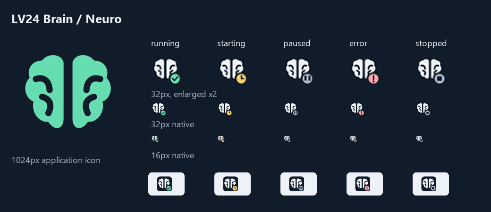

# Neuro identity

The owner selected **option 1, Neuro**, on 11 November 2026. It replaces the
previous geometric memory-cell mark with the approved two-hemisphere silhouette.
This source change does not alter the currently published version or updater.

## One source, all sizes

- `src/shared/brand/mark.json`: approved cubic silhouettes, cutout paths and
  references to semantic CSS color tokens.
- `src/shared/brand/BrandMark.tsx`: header/wordmark symbol in `currentColor`, with
  an instance-specific transparent SVG mask. Mask values are preserved in
  forced-color mode.
- `scripts/generate-icons.ps1`: native System.Drawing generation from the same
  absolute M/L/C/Z paths; no network or new dependencies. Numeric geometry uses
  invariant parsing. Silhouettes and cutouts are validated before output writes.
- `public/brand/mark.svg` and `mark-monochrome.svg`: app/favicon and standalone
  monochrome marks.
- `src-tauri/icons/`: all PNG, ICO and ICNS outputs, plus running, starting,
  paused, error and stopped tray states. Status glyphs and native file names stay
  intact. The app/tray glyph is inset so brain lobes are not clipped at corners.

```powershell
powershell -NoProfile -ExecutionPolicy Bypass -File scripts/generate-icons.ps1
```



## Verification

- `npm run check`: 23 test files, 113 tests, TypeScript and Vite build pass.
- The added compositing test checks that two marks use distinct SVG mask IDs.
- Both SVG assets parse; all 11 PNG files have the expected dimensions; seven
  ICO frames and all seven ICNS representations decode.
- Second generator run: all 15 asset SHA256 hashes are unchanged.
- `npm run tauri build -- --debug --no-bundle`: debug application builds with
  the regenerated icon assets.
- Local browser fixture: the header renders two hemispheres at 32px and retains
  mask compositing colors; [dashboard preview](neuro-dashboard.jpg). It uses
  fictional fixture versions/data and is not a screenshot of the installed app.
- The two silhouettes match the approved Neuro SVG exactly. Native 16/32px tray
  previews are shown above; these are generated assets, not a native tray capture.

Historical design-refresh screenshots document the prior version. New icons
appear in installed windows/taskbars/tray after installing a build containing
these assets; Windows can retain icon cache entries for an existing installation.
